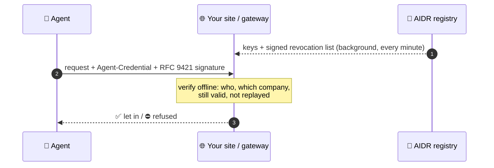

<div align="center">

# 🛂 AIDR — passports for AI agents

**Every AI agent that knocks on your API can prove who it is, and which company answers for it.**
Verified offline, in your own code, against an open standard.

[](https://aidr.evolivcore.com/explorer)

[](https://pypi.org/project/aidr-verifier/)
[](https://www.npmjs.com/package/@evoliv/aidr-verifier)
[](https://pkg.go.dev/github.com/evolivcore/aiaf-sdk/go)
[](https://github.com/EvolivCore/aiaf-sdk/actions/workflows/conformance.yml)
[](LICENSE)

</div>

---

## 🤖 The problem

AI agents now read, buy and book on the web. To a website they all look the same: a user-agent
string anyone can copy. You cannot tell a research agent from a scraper wearing its name, so you
either let everything in or block everything.

## ✅ The fix, in one picture



The registry is never asked about a request: it never learns which sites an agent visits. Nothing
in this repository reports installs, usage or destinations.

## 👀 What your site learns, in milliseconds

| | |
|---|---|
| 🆔 **Who is calling** | the exact agent, `aid:v1:acme-corp:01M3…`, not a copyable string |
| 🏢 **Who answers for it** | the accountable organisation, and the domain it proved it owns |
| 🔒 **How far to trust it** | assurance levels for the organisation and for how its key is held |
| ⛔ **Whether to let it in** | forged, replayed and revoked agents are refused, everywhere, within minutes |

> **See it before you install anything:** the [Explorer](https://aidr.evolivcore.com/explorer)
> runs these exact checks in your browser on a genuine, a revoked and a forged agent.

---

## ⚡ Sixty seconds to your first verified agent

### 🌐 Protect a website or API

<table>
<tr><td><b>Node.js / Express</b></td><td>

```js
import { aidr } from '@evoliv/aidr-verifier';
app.use(aidr({ issuer: 'https://api.evolivcore.com', publicOrigin: 'https://api.example.com' }));
// req.aidr.status: 'anonymous' | 'verified'  — and req.agent when verified
```
</td></tr>
<tr><td><b>Python / FastAPI</b></td><td>

```python
from aidr_verifier import AidrMiddleware, RelyingPartyConfig   # pip install "aidr-verifier[fastapi]"
app.add_middleware(AidrMiddleware, config=RelyingPartyConfig(
    issuer="https://api.evolivcore.com", public_origin="https://api.example.com"))
# request.state.aidr — Flask (WSGI) and Django middleware too
```
</td></tr>
<tr><td><b>Go</b></td><td>

```sh
go get github.com/evolivcore/aiaf-sdk/go@v0.2.1
```
</td></tr>
</table>

People are never affected: requests without agent headers pass straight through, unless you
choose a verified-agents-only path.

### 🚪 Or at the gateway, with no code change

| Gateway | Where |
|---|---|
| ☁️ Cloudflare Workers | [`edge/cloudflare-worker`](edge/cloudflare-worker) |
| 🟧 Amazon API Gateway (Lambda authorizer) | [`edge/aws-lambda-authorizer`](edge/aws-lambda-authorizer) |
| 🦍 Kong Gateway | [`edge/kong-plugin`](edge/kong-plugin) |
| 📝 WordPress | [`edge/wordpress`](edge/wordpress) |

### 🧠 Building an agent? Give it a passport

```python
from aidr_agent import Agent                      # pip install "aidr-agent[langchain]"
from aidr_agent.langchain import aidr_http_tools  # or aidr_agent.llamaindex

agent = Agent.load_or_enroll("research-01", audiences=["https://api.example.com"])
tools = aidr_http_tools(agent)   # http_get / http_post: every request signed as your agent
```

First run: put an enrollment token from the [AIDR console](https://console.evolivcore.com) in
`AIDR_ENROLLMENT_TOKEN`; the key is generated on your machine and never leaves it. Node.js and the
Vercel AI SDK: `npm install @evoliv/aidr-agent`.

---

## 🧭 Why you can trust the verifier

- 🔓 **Open source, Apache-2.0.** Read every line that decides whether an agent gets in.
- 📐 **Built on standards.** RFC 9421 HTTP Message Signatures; Ed25519 and ES256 compact JWS;
  the [AIAF draft](spec/) is in this repository.
- 🧪 **One truth, five implementations.** The Python, Node.js and Go verifiers, the Cloudflare Worker
  and the gateway plugins replay the same [test vectors](sdk/testdata/) and must reach the same verdict,
  on every change.
- 🤝 **Speaks Web Bot Auth.** One setting (`web_bot_auth=` / `webBotAuth:`) and an agent's requests
  are standard [Web Bot Auth](https://datatracker.ietf.org/group/webbotauth/about/) requests in
  Cloudflare's format, checked against Cloudflare's own open-source verifier; the SDKs also sign the
  key directory you register with Cloudflare.
- 🛡️ **Fails closed.** Stale revocation data, an unknown key, a replayed nonce or a signature made
  for another host: refused, never waved through.

## 🗺️ What is in here

| Path | What | Install |
|---|---|---|
| `go/` | Verifier for Go, standard library only | `go get github.com/evolivcore/aiaf-sdk/go` |
| `sdk/node/` | Verifier for Node.js, with Express middleware | `npm install @evoliv/aidr-verifier` |
| `sdk/node-agent/` | Agent SDK for Node.js, with Vercel AI SDK tools | `npm install @evoliv/aidr-agent` |
| `sdk/python/aidr_verifier/` | Verifier for Python: ASGI, FastAPI, WSGI, Django | `pip install aidr-verifier` |
| `sdk/python/aidr_agent/` | Agent SDK for Python, with LangChain and LlamaIndex tools | `pip install aidr-agent` |
| `libs/` | `aidr-core` and `aidr-crypto`, which the Python packages use | installed with them |
| `edge/` | Cloudflare Worker, API Gateway authorizer, Kong plugin, WordPress plugin | see each README |
| `sdk/testdata/` | The shared vectors every implementation must agree on | |
| `spec/` | The AIAF draft | |

The Go module is at `go/`, not under `sdk/`, because a Go module's path must match where it sits.

## 🧪 Run the conformance suite yourself

```sh
(cd go && go test ./...)
(cd sdk/node && npm test)
(cd sdk/node-agent && npm test)
(cd edge/cloudflare-worker && npm test)
(cd edge/aws-lambda-authorizer && npm test)
(cd edge/kong-plugin && npm test)
pip install cryptography pytest
PYTHONPATH=libs:sdk/python python -m pytest tests
```

## 🤝 Contributing

Issues are welcome here. This repository is written by a release script from Evoliv Core's
source repository, one commit per release, so a pull request is reviewed here and applied at the
source; it arrives in the next sync rather than being merged directly.

🔐 Report a security problem privately, not in an issue: the **Security** tab, *Report a vulnerability*.

<div align="center">

---

**[▶ Try the Explorer](https://aidr.evolivcore.com/explorer)** · **[Product](https://aidr.evolivcore.com)** ·
**[Resources](https://evolivcore.com/resources)** · ⭐ Star the repo if agents should carry passports.

</div>
